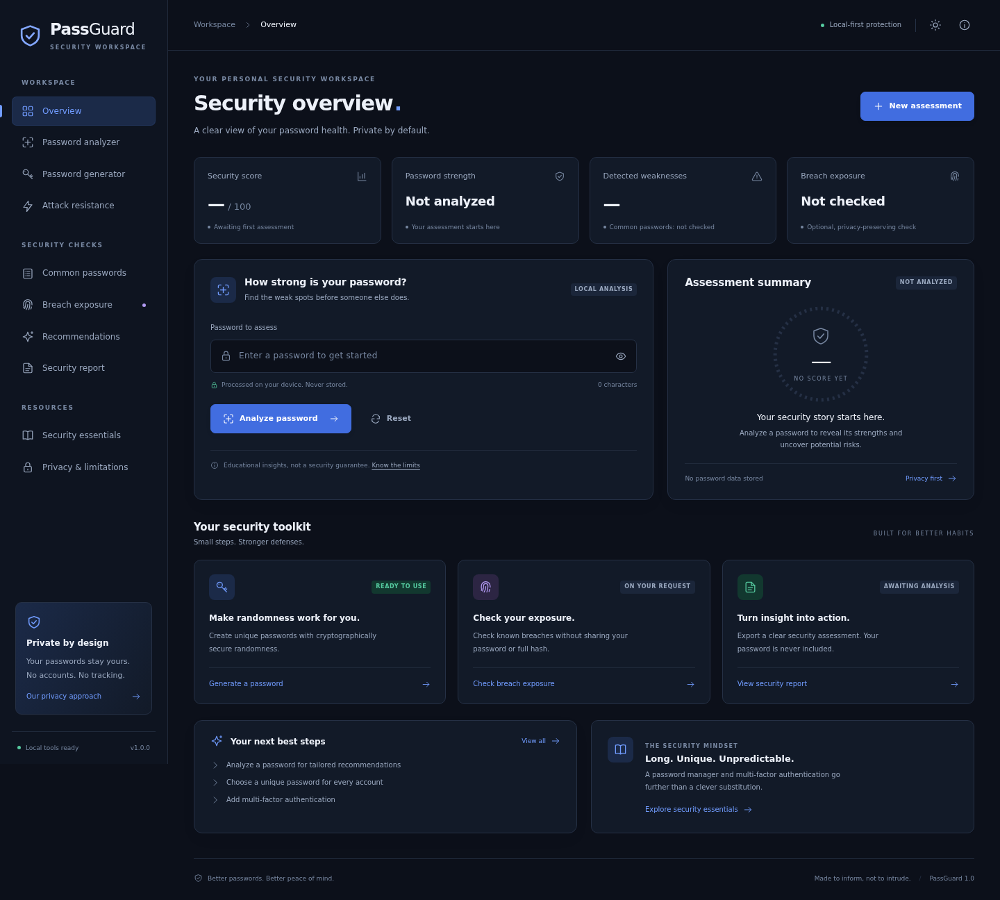

# PassGuard

### Password Strength and Security Assessment Tool

**A local-first security workspace. Understand your passwords without giving them away.**

PassGuard is a complete, framework-free HTML/CSS/JavaScript application for cybersecurity education, college demonstrations, academic submission, and a frontend portfolio. It combines a transparent strength heuristic, pattern detection, theoretical attack models, secure password generation, an optional privacy-preserving exposure check, and locally generated reports.



> Use synthetic passwords for demonstrations. The examples in this repository are public test fixtures—never use them as real credentials. Scores and time estimates are educational, not guarantees.

## Run locally — no Arena account, preview, or agent required

PassGuard runs from your existing folder on **your own computer**. Requirements: **Node.js 20+** (prefer a currently supported LTS) and a normal browser such as Firefox. There is no application backend, framework, build step, database, API key, or runtime npm dependency. **Neither Arena nor Python nor browser automation is required.**

### Kali / Linux: recommended launcher

```sh
cd ~/Downloads/passguard
chmod +x start-passguard.sh
./start-passguard.sh
```

The script serves **http://localhost:3000**, stays in the foreground, and requests your OS's default browser when a graphical session is available. It pins the local binding to **127.0.0.1** even if your shell happens to export HOST/PORT. For no browser opening, use `./start-passguard.sh --no-open`. `bash ./start-passguard.sh` also works if executable permission was lost during extraction. The script resolves its own project directory, so invocation by absolute path works from another directory, including paths with spaces.

- **Already serving PassGuard:** report the URL and reuse it; no duplicate server is started. A read-only identity probe recognizes the current launcher; an exact homepage-byte comparison recognizes older copies of this project. An HTML title alone is not trusted.
- **Another app or unverified listener on port 3000:** show a clear conflict and exit **73**. No process is killed and there is **no automatic fallback to 8000**. IPv4/IPv6 localhost listeners are checked to avoid opening another app accidentally.
- **Browser unavailable/headless/CI:** print the URL and keep the server functional. No Playwright, browser driver, or browser download is needed for startup. A desktop-helper request is best-effort, not proof that a tab opened.
- **Stop:** Ctrl+C in the terminal that owns the running server. Closing the browser tab does not stop it. If a second launch reused an instance and exited, stop the original terminal/service instead.
- **Restart:** wait for `PassGuard stopped.`, then run `./start-passguard.sh` again. Static source edits need a browser reload; changes to server code require stopping/restarting its owner. No bundler/hot reload was added.

### npm alternatives

```sh
cd ~/Downloads/passguard
npm start
# Equivalent server launcher:
npm run dev
# Optional OS-browser opening:
npm run start:open
# Or:
npm start -- --open
```

All use the same idempotent Node launcher, with **127.0.0.1:3000** as the default. No `npm install` is necessary to serve this dependency-free application. If you run `npm install`/`npm ci`, it installs only the project's existing optional browser-test tools; those are not needed for normal operation. `npm install --omit=dev` is also sufficient for local app use.

A fresh instance prints a confirmed URL only after listening:

```text
PassGuard — local development server
  Local:   http://localhost:3000
  Bound:   127.0.0.1:3000
  Stop:    Ctrl+C
```

Open **http://localhost:3000** in Firefox if automatic browser opening is disabled or unavailable. Both npm and OS launchers require the owning terminal to stay open unless you intentionally install the optional user service described below.

### Windows launcher

With Node.js 20+ installed, run **`start-passguard.bat`** from the existing project folder (or double-click it). It uses the same loopback/port checks, stays in a console for Ctrl+C, and requests the default browser. In a Command Prompt:

```bat
cd /d "%USERPROFILE%\Downloads\passguard"
start-passguard.bat
```

Use `start-passguard.bat --no-open` to suppress the browser request. Windows wrapper quoting/native-helper selection were reviewed/tested structurally on Linux; **a real Windows session was not available**, so native Windows behavior is not represented as executed verification.

### Explicit configuration and trusted network preview

```sh
# Deliberately choose another port; it never silently replaces the 3000 default.
npm run dev -- --port 8000
# Pin ordinary local use explicitly:
npm start -- --host 127.0.0.1 --port 3000
# Help:
npm start -- --help
# Intentional trusted network/hosted preview ONLY, not a local requirement:
HOST=0.0.0.0 PORT=3000 npm run dev -- --no-open
```

HOST/PORT or `--host`/`--port` override npm defaults; CLI options take precedence. Supported hosts: `127.0.0.1`, `localhost`, `::1`, `0.0.0.0`; ports: integers 1–65535. IPv6-only binding prints `http://[::1]:<port>`. The OS wrappers set safe defaults before your explicit additional flags. Use `unset HOST PORT` if your shell exports unexpected settings. Network binding must be an intentional override; it does not make plain HTTP on a LAN IP a secure browser context.

Optional **user-level auto-start on login** is provided as a template, **not installed or enabled automatically**: see [local operation / auto-start](docs/localhost-setup.md#optional-linux-auto-start-on-login). It has explicit start/stop/restart/disable commands and does not open a browser at login. You may still use the shell launcher to open the already-running local app.

### Prerequisites and troubleshooting

Check `node --version` (20+) and `npm --version`. If missing on Kali, install with your package manager, for example `sudo apt update` then `sudo apt install nodejs npm`, and verify the version before continuing. Use your normal user, not `sudo npm start` or `sudo npm install`. If Firefox is missing, install it separately (Kali commonly uses `firefox-esr`). These are instructions for your machine; no Kali filesystem or OS was modified by the assistant.

| Symptom | Action |
| --- | --- |
| Node missing/unsupported | Install a supported Node LTS locally and open a fresh terminal. No Arena process can replace your local Node installation. |
| Port 3000 conflict (exit 73) | Inspect `ss -ltnp` on Linux, or `netstat -ano` on Windows. Stop the identified owner only if appropriate. Do not kill all Node processes. The launcher will not silently move or terminate another app. |
| PassGuard already running | Use the printed URL. This invocation does not own that instance; stop/restart its original terminal or user service. Stop an old launcher before starting updated server code. Reuse preserves the existing owner's bind address and configuration; stop/restart that owner to change them. |
| Missing npm script / `package.json` | Use the existing project folder. Apply the complete update (both server helper files and wrappers); do not run `npm init` or create a replacement app. |
| Shell permission denied | Use `chmod +x start-passguard.sh` or `bash ./start-passguard.sh`; inspect project ownership if previous root use caused problems. Never use `chmod -R 777`. |
| Browser did not open | Open http://localhost:3000 yourself. Linux uses xdg-open/gio in GUI sessions; Windows uses its default URL handler. Browser-opening failure does not stop the server. |
| Blank page/module error | Use HTTP localhost, not `file://`; reload with Ctrl+Shift+R and check Console/Network. Local modules/CSS/assets have correct MIME; unknown assets return 404. |
| Clipboard / Web Crypto unavailable | Use a normal localhost/HTTPS tab. Denied clipboard writes offer manual copying; do not disable browser security or add insecure RNG. |
| Live breach request fails | This is **Check failed**, not a negative lookup. Only an explicit click uses the official service; local tools remain available. |
| Docs or package files return 404 | Intentional: only public index/CSS/JS/assets plus a tiny read-only service-identity endpoint are served. Open documentation in an editor. |

Internet is unnecessary for local analysis, generation, estimates, and reports after Node is installed. Only an explicitly requested exposure check needs the external service. No entered passwords are sent to the local static server. The identity probe contains fixed app/protocol metadata, not credentials, process-control operations, filesystem paths, or authentication tokens; it is duplicate prevention, **not authentication**.

The Arena copy was edited; your unmounted Kali folder was not. See [safe update / exact local lifecycle commands](docs/localhost-setup.md) and [actual verification records](docs/test-results.md).

## Problem statement

A password with several character types can still be an obvious word with a suffix. Conversely, a large theoretical entropy value says little about a human's predictable choices. Many simplistic strength meters obscure these differences or give unwarranted confidence after a negative database lookup.

PassGuard brings the evidence and the assumptions into one workspace, with no fabricated initial results and no silent external checks.

## Objectives

1. Explain password weaknesses without collecting credentials.
2. Use one consistent analysis engine and one documented score across all sections.
3. Separate theoretical exhaustive search from practical pattern-based guessing.
4. Generate passwords with browser-native cryptographic randomness.
5. Distinguish a small local example-list check from an optional online exposure check.
6. Export useful assessments without including passwords or complete hashes.
7. Provide runnable automated tests and reproducible manual tests.

## Features — all seven phases integrated

| Section               | Working functionality                                                                                                                                                                                               |
| --------------------- | ------------------------------------------------------------------------------------------------------------------------------------------------------------------------------------------------------------------- |
| Overview              | Actual state-driven score, strength, weakness count, character summary, local-list status, exposure state, next steps, generator availability, and report availability. Honest initial and outdated states.         |
| Password analyzer     | Explicit analysis; show/hide; reset; 0–100 score; Weak/Medium/Strong classification; character counts; pattern explanations; theoretical entropy; contextual recommendations.                                       |
| Password generator    | 8–64 characters; four category controls; Web Crypto rejection sampling; mandatory selected categories; secure shuffle; copy with manual fallback; clear; analyze through the same engine.                           |
| Attack resistance     | Separate N and N/2 estimates; overflow-safe logarithms; four hypothetical scenarios; editable applied rates; readable durations; pattern-aware risk indicators. No attacks are executed.                            |
| Common passwords      | 50 bundled, hand-curated examples; case-sensitive exact matches; separate heuristic warnings. Also checked automatically during local analysis.                                                                     |
| Breach exposure       | Explicit-click official Pwned Passwords range lookup; local SHA-1; five-character prefix only; padded response; local suffix comparison; cancellation, timeout, malformed-response and HTTP/network error handling. |
| Recommendations       | Context-aware action plan; additional advice when exposure is found; length, uniqueness, password managers, and MFA—not arbitrary complexity rules.                                                                 |
| Security report       | Actual results and honest missing/failed-check labels; preview; self-contained HTML download; text download; print / browser Save as PDF; clear.                                                                    |
| Security essentials   | Length, uniqueness, randomness, MFA, phishing, exposure response, and explanatory FAQs.                                                                                                                             |
| Privacy & limitations | Feature-by-feature data boundaries, assumptions, browser constraints, and residual risk.                                                                                                                            |

Dark/light themes, keyboard focus, labeled inputs, responsive navigation with a mobile focus loop and Escape handling, reduced-motion support, and print-only report styling are included. Themes and preferences are memory-only.

## Technology stack

- Semantic HTML5; CSS3 custom properties, Grid, and Flexbox.
- Vanilla JavaScript ES modules.
- Web Crypto (`getRandomValues` and protocol-compatible `subtle.digest('SHA-1')`).
- Clipboard API; Blob/object-URL downloads; browser printing.
- Node.js 20+ built-in static development server and native test runner; zero runtime packages.
- **Optional development-only** Playwright and axe-core for real-browser integration and accessibility scans. No testing library is delivered to the browser.

## Folder structure

```text
passguard/
├── index.html
├── README.md
├── .gitignore
├── package.json                # Scripts, ES-module mode, optional test-only dependencies
├── package-lock.json           # Reproducible development-tool versions
├── start-passguard.sh          # Local Linux foreground startup / reuse / browser
├── start-passguard.bat         # Windows launcher (native Windows test pending)
├── scripts/
│   ├── dev-server.mjs          # Node static transport; fixed port / idempotent CLI
│   └── local-startup.mjs       # Bounded identity probes and optional OS URL opening
├── assets/
│   └── favicon.svg             # Original, local SVG; all UI icons are inline SVG
├── css/
│   ├── style.css
│   ├── responsive.css
│   └── print.css
├── js/
│   ├── app.js                  # Events, async orchestration, lifecycle clearing
│   ├── ui.js                   # Rendering, navigation, theme, accessible controls
│   ├── state.js                # Memory-only state machine and stale-result guards
│   ├── password-validation.js  # Shared length/type/control-character boundary
│   ├── analyzer.js             # Single assessment entry point
│   ├── character-analysis.js
│   ├── weakness-detector.js
│   ├── entropy-calculator.js
│   ├── strength-score.js       # The only scoring implementation
│   ├── recommendations.js
│   ├── attack-estimator.js
│   ├── crack-time-estimator.js
│   ├── risk-indicators.js
│   ├── password-generator.js
│   ├── clipboard.js
│   ├── common-password-checker.js
│   ├── breach-checker.js
│   ├── security-report.js
│   ├── report-export.js
│   └── formatters.js           # HTML escaping, dates, large occurrence counts
├── docs/
│   ├── architecture.md
│   ├── manual-testing.md
│   ├── security-audit.md
│   ├── test-results.md
│   ├── dependency-audit.json
│   ├── browser-test-results.json
│   ├── firefox-test-results.json
│   ├── localhost-http-results.json
│   ├── localhost-setup.md
│   ├── unit-test-results.txt
│   ├── systemd/
│   │   └── passguard.service.example # Optional, never auto-enabled
│   └── screenshots/
│       ├── overview.png        # Actual empty-state browser capture
│       ├── mobile.png
│       ├── overview-firefox.png
│       └── mobile-firefox.png
└── tests/
    ├── analysis.test.js
    ├── attack.test.js
    ├── generator.test.js
    ├── breach.test.js
    ├── report-state.test.js
    ├── security-structure.test.js
    ├── dev-server.test.js
    ├── local-startup.test.js
    └── browser-smoke.mjs
```

Each requested module has a real responsibility. The additional state, validation, clipboard, and formatting modules isolate testable security boundaries; they do not introduce competing analysis engines. See [architecture](docs/architecture.md).

## How to use

1. Enter a **synthetic** password on Overview or Password analyzer. These inputs mirror the same in-memory value.
2. Select **Analyze password** (or press Enter in the input).
3. Review the same current result in Overview, Analyzer, Attack resistance, Common passwords, and Recommendations.
4. Optionally generate a replacement and choose **Analyze** in the generator.
5. Optionally open Breach exposure, read the disclosure, and explicitly select **Check breach exposure**.
6. Generate a report. Download HTML or text, or select **Print / PDF** and choose your browser's PDF destination.
7. Use **Reset / Clear workspace** to remove passwords, generated output, assessment, breach state, and report from application state. Theme, generator settings, and applied hypothetical rates can remain for the current page session.

### Current versus outdated results

Changing the password immediately marks previous analysis as outdated, hides it from current metrics, invalidates the report and exposure result, and cancels an in-flight breach check. Returning to the original text still requires a new explicit analysis. Re-analysis also invalidates previous exposure and reports. Scenario changes invalidate the report only after **Update assumptions** is selected. Starting or completing a breach check and rerunning a local check also clear an existing report.

The generator output is independent until **Analyze** is selected. Generator settings changes clear the generated output rather than implying an older password follows new settings.

## Documented scoring algorithm

Let **L** be the number of Unicode code points and **C** the number of present categories (ASCII uppercase, ASCII lowercase, ASCII digits, and special/other).

```text
lengthPoints  = min(90, 4 × L)
varietyPoints = 5 × max(0, C − 1)          # At most 15 points
base          = min(100, lengthPoints + varietyPoints)
score         = max(0, min(lowest applicable cap, round(base − sum(penalties))))

Weak: 0–39       Medium: 40–69       Strong: 70–100
```

Penalties may accumulate; caps prevent length or character variety from rescuing an obvious pattern.

| Detected condition                                        |         Penalty | Score cap |
| --------------------------------------------------------- | --------------: | --------: |
| Fewer than 8 characters                                   |              30 |        20 |
| 8–11 characters                                           |               6 |        69 |
| Exact local-list match                                    |              35 |        15 |
| One distinct character                                    |              40 |         5 |
| Run of at least 3 identical characters                    |              12 |        55 |
| Entire password repeats a smaller block                   |              25 |        30 |
| Repeated words / alphabetic blocks                        |              12 |        45 |
| Ascending/descending sequence of at least 4               |              15 |        60 |
| Listed keyboard walk of at least 4                        |              20 |        50 |
| Familiar published phrase                                 |              25 |        25 |
| Small dictionary match                                    |              10 |       100 |
| At least 4 detected dictionary words and length ≥24       | 5 instead of 10 |       100 |
| Predictable substitution revealing a dictionary base      |              18 |        45 |
| Dictionary-like base with simple numeric/symbol additions |              22 |        30 |
| Calendar-year-like ending                                 |               5 |       100 |

Sequence and keyboard detection examines short windows in explicit local rows. Repeated-block detection checks full repetition; repeated-word detection checks separated tokens and whole repeated alphabetic blocks. Leet normalization checks familiar substitutions such as `@→a` and `0→o`. Familiar-phrase detection covers a few public examples, not arbitrary quotations. The local list and demonstration dictionary are bundled in `common-password-checker.js`; neither is comprehensive or a current frequency ranking.

**Limitations:** This rule is intentionally transparent and testable, not a calibrated guess-count model. It can miss names, personal context, multilingual words, unfamiliar keyboard layouts, partial repetitions, and sophisticated combinations. False positives are possible. A Strong result does not establish randomness, uniqueness, non-exposure, or security. Breach results remain separate and do not silently change the score.

## Character and entropy assumptions

- Input is bounded to **1,024 UTF-16 code units** to bound work. Length statistics count Unicode **code points**, not grapheme clusters. For example, a displayed emoji sequence may contain several code points.
- Control characters are rejected. Spaces and Unicode text are accepted; no trimming or case normalization is applied to the password itself.
- Uppercase/lowercase/digit counts use ASCII ranges. Everything else is counted as special/other.
- The assumed pool includes 26 uppercase, 26 lowercase, 10 digits, 32 ASCII punctuation characters, and one space, **only when present**.
- Distinct observed non-ASCII code points are added as an explicit conservative pool proxy. This is not a full Unicode alphabet model.

```text
Theoretical entropy (bits) = L × log₂(assumed pool size)
```

This formula assumes independent, uniformly random choices. Human-created patterns violate that assumption, so entropy can significantly overestimate security. A generator that guarantees categories does not sample uniformly from every possible valid string; this value is not a measured entropy claim about the generator either.

## Search-space and crack-time assumptions

```text
N = pool size ^ L
Expected exhaustive-search attempts ≈ N / 2
log₁₀(N) = L × log₁₀(pool size)
log₁₀(seconds) = log₁₀(N / 2) − log₁₀(guesses per second)
```

Total candidates and expected attempts are displayed separately. Logarithmic calculations prevent numeric overflow even at the input limit. Large results are rounded scientific notation; these are not exact integer counts.

Default **hypothetical** rates, editable in the UI or in `js/attack-estimator.js`:

| Scenario                      | Example guesses/second |
| ----------------------------- | ---------------------: |
| Online, strict rate limit     |                    0.1 |
| Online, weaker rate limit     |                     10 |
| Offline, relatively slow hash |                 10,000 |
| Offline, relatively fast hash |         10,000,000,000 |

These are neither benchmarks nor universal rates for named algorithms. They assume continuous exhaustive search. Real attackers prioritize likely passwords; hashing methods and cost parameters, salts, hardware, rate limiting, account lockouts, MFA, and attacker knowledge matter. No cracking, account access, or hardware benchmark is performed. Allowed applied rates are finite values from 0.001 through 10¹⁸ guesses/second.

## Secure generator design

`crypto.getRandomValues()` supplies 32-bit samples. For a pool of size `m`, values at or above `floor(2³²/m) × m` are rejected before modulo reduction, avoiding modulo bias. One character is selected from each enabled category, the remainder from the combined pool, then the entire result is shuffled with a cryptographically driven Fisher–Yates shuffle.

Settings are validated. Selecting no categories, invalid lengths, or missing Web Crypto causes an actionable error. There is **no insecure randomness fallback**. Generated candidates are not automatically assigned a perfect score, copied, stored, or transmitted.

Clipboard success is displayed only after `writeText()` resolves. If unsupported or denied, the existing output is selected and manual copying is explained. Clipboard contents/history are outside PassGuard's reset boundary.

## Breach-check workflow and privacy

Based on the [official Pwned Passwords documentation](https://haveibeenpwned.com/API/v3#PwnedPasswords):

1. The user first completes a current analysis, then **explicitly clicks** the exposure button.
2. Web Crypto calculates the SHA-1 of the exact UTF-8 encoded password locally.
3. The uppercase hexadecimal hash is split into a five-character prefix and a 35-character suffix.
4. The only password-derived request data is the prefix:
   `GET https://api.pwnedpasswords.com/range/{PREFIX}`.
5. The request uses `Add-Padding: true`, no credentials, no referrer, no cache, and no redirects.
6. The full response is validated before any match or negative result is trusted. Zero-count padding entries do not count as exposure. Occurrence counts are decimal strings backed by BigInt parsing, avoiding unsafe integer truncation.
7. The suffix comparison happens locally. Passwords, full hashes, and suffixes are absent from returned state and reports.
8. A successful validated response with no nonzero matching suffix yields **No match found in the checked dataset**. Network, rate limit, HTTP, body-read, malformed-response, and timeout failures yield **Check failed**—never a negative result.
9. A 10-second timeout covers hashing, the request, and reading the body. Reset, input changes, re-analysis, and Cancel abort and/or invalidate pending results.

The service still sees the prefix, IP address, and normal request metadata. K-anonymity and padding reduce disclosure; they do not make networking invisible. SHA-1 is used solely for this API protocol, **not recommended for password storage**. The service requires no paid key.

### Privacy safeguards

- No localStorage, sessionStorage, IndexedDB, application cookies, analytics, telemetry, third-party scripts, external fonts, or trackers.
- No password or full-hash logging, URLs, requests, report fields, or persistent application storage.
- No background requests on typing, blur, analysis, navigation, generation, or report creation.
- Passwords exist temporarily in browser memory and controlled input values; clearing references is best-effort, not forensic erasure.
- All HTML report dynamic values are escaped. Password strings are only assigned to input/textarea `value`, never interpolated into HTML.
- Application CSP restricts scripts/styles to local files and connections to the local origin and official breach service. Exported reports have a stricter self-contained CSP and no scripts.
- Reset cannot erase previous clipboard contents, screenshots, downloaded reports, browser/OS traces, or an extension's observations.

See [security review](docs/security-audit.md) for evidence and residual risks.

## Testing

### Dependency-free native and localhost-server tests

From the project directory with Node.js 20+:

```sh
cd ~/Downloads/passguard
npm test
# Static transport and local launcher checks:
npm run test:local
# Original static-transport suite only:
npm run test:server
```

No package installation is needed for these native tests. Only synthetic fixtures and mocked breach responses are used. Coverage includes analysis, character counts, patterns, scores, Unicode assumptions, overflow-safe attack estimates, all 15 generator category combinations, 200 generator outputs, rejection sampling, missing crypto, clipboard errors, prefix-only breach privacy/error states, report escaping, state races, reset, import integrity, CSP, and source-security boundaries.

Server/startup tests cover fixed loopback defaults, real HTTP/MIME/headers, public/private path and symlink boundaries, identity/legacy detection, foreign/silent/oversized/redirected listeners, IPv6 conflicts, simultaneous launch races, reuse/no duplicate ownership, supervised conflicts, CLI help, cwd/path spaces, inherited environment safety, Ctrl+C/restart, and OS-opener selection/failure. Programmatic explicit multi-port transport fallback is retained and tested, but CLI startup no longer silently selects 8000.

### Optional Firefox integration (separate terminal)

Keep `npm run dev` running in the first terminal. In a second terminal:

```sh
cd ~/Downloads/passguard
npm install
npx playwright install firefox
# Only if Playwright reports missing Linux system libraries:
# npx playwright install-deps firefox
npm run test:firefox
```

These commands use **Playwright's testing build of Firefox**, not a claim of testing your actual Kali Firefox ESR/profile. The downloaded test browser and its optional system libraries are unnecessary for normal app use. The package versions already present in the project are pinned; no new runtime packages were added.

The browser runner defaults to port 3000. If you deliberately chose port 8000, pass that URL:

```sh
PASSGUARD_URL=http://localhost:8000 npm run test:firefox
```

For optional Chromium regression testing, install its test browser with `npx playwright install chromium`, then run `npm run test:browser` (the same PASSGUARD_URL override works). Linux hosts may need the corresponding `npx playwright install-deps chromium` command.

Both browser suites exercise actual analyzer/generator controls, entropy/character/weakness displays, recommendations/risk estimates, stale/reset behavior, real HTML/text downloads, print-media styles, mobile navigation, six viewport widths, dark/light axe scans, and intercepted prefix-only exposure requests. Every exposure response is **mocked**; unexpected external traffic is blocked. Intentional aborted/HTTP 429 mocks have their known browser diagnostics recorded separately; unrelated CORS/console errors still fail.

**Capability limits:** Chromium verifies actual clipboard writing with granted permissions and actual headless PDF output. Firefox's successful Clipboard API boundary is explicitly **mocked**; its denial/manual-copy and async UI paths are exercised, but actual Firefox clipboard permissions remain manual. Print invocation is spied on in both; Playwright PDF generation is Chromium-only. No human-operated native print dialog is claimed as tested. Only cleared-state screenshots are saved, separately for each browser.

See [executed test results](docs/test-results.md), [native TAP](docs/unit-test-results.txt), [Chromium JSON](docs/browser-test-results.json), [Firefox JSON](docs/firefox-test-results.json), and [localhost HTTP/fallback evidence](docs/localhost-http-results.json) for actual results and timestamps. Follow the [manual checklist](docs/manual-testing.md) for your Kali Firefox, native permission dialogs, print destinations, physical devices, and assistive technology.

## Known limitations and intentionally unavailable capabilities

- Educational heuristic, small local list, and English-centric patterns—not a production-grade guess-rank estimator or an authoritative safe/unsafe verdict.
- No passphrase generator, password vault, login service, account lookup, or actual cracking engine. These are outside this project's scope.
- The optional live breach lookup needs Internet, API availability, CORS support, and secure-context Web Crypto. Live service behavior was **not** used to manufacture test outcomes; tests are mocked.
- Clipboard permission and print/PDF destinations vary by browser and OS. Headless tests cannot validate a human-operated system print dialog.
- Automated accessibility checks are useful evidence, not a substitute for screen-reader and keyboard usability review.
- Browser memory cannot be securely zeroed by JavaScript. An untrusted host, malware, extensions, or clipboard sync can defeat local processing protections.
- No service worker or installable PWA. Local tools work without Internet while the static server is accessible; there is no promise of an offline-hosted reload.
- This is an engineering self-review, not a professional penetration-test or cryptographic certification. No repository was published or files uploaded to a remote service.

## Future improvements

- A separately audited random-word passphrase generator with a documented local word list.
- More internationalized pattern handling and explicit regional keyboard layouts.
- Wider Kali Firefox ESR/profile, Safari/device, and assistive-technology testing beyond the recorded headless Firefox/Chromium runs.
- Optional, user-controlled passkey awareness and organization-specific educational guidance.
- Independent review of scoring calibration and the implementation's threat model.

---

Built to inform, not to intrude. **PassGuard 1.0.0**
